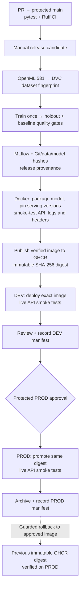

# Advanced Regression MLOps
[](https://github.com/EmaDeq/advanced-regression-mlops/actions/workflows/ci.yml)
[](LICENSE)

**An end-to-end, production-style MLOps case study:** from reproducible regression training and experiment lineage to a tested Docker image, guarded DEV → PROD promotion, operational monitoring, and a **successfully executed production rollback**.

**What this demonstrates:** the ability to take ownership of the *ML lifecycle*, not just model training. The complete workflow was implemented and verified using Python, scikit-learn, DVC, MLflow, GitHub Actions, Docker/GHCR, FastAPI, and two Render Free services.

> **Scope:** a publicly documented **educational portfolio demonstration**, not a production service for real users. The historical Boston Housing dataset is ethically problematic and must never be used for consequential housing decisions. See [data ethics](docs/data_ethics.md). DEV and PROD may be intentionally **suspended** to preserve free-tier hours.

## What I built

| Engineering area | Implemented and demonstrated |
| --- | --- |
| **Model development** | HistGradientBoostingRegressor, 80/20 holdout, 5-fold CV tuning, Dummy/Ridge baselines, R² / MAE / RMSE quality gates |
| **Data and experiment lineage** | DVC-tracked dataset fingerprint; local and CI MLflow; Git SHA, model SHA-256, parameters, metrics and dependency versions recorded in release provenance |
| **CI and release engineering** | Protected `main`, required pytest/Ruff checks, manual build, training-once policy, checksum verification, container API acceptance tests |
| **Immutable delivery** | The **same smoke-tested GHCR image digest** is deployed to DEV and promoted to PROD after manual approval |
| **Release management** | Git-tracked DEV/PROD manifests, archived releases and a **real, guarded B → A rollback**, verified on Render |
| **Observability and safety** | JSON request/latency/status logs, request IDs, schema validation, rejection of NaN/Inf, HTTP security headers and non-root Docker runtime |

### Verified model result

**Historical OpenML 531 benchmark:** 506 observations, 12 selected predictors (excluding the racially constructed `B` feature). Representative held-out evaluation from a [verified CI run](https://github.com/EmaDeq/advanced-regression-mlops/actions/runs/39937525166):

| R² ↑ | MAE ↓ | RMSE ↓ |
| ---: | ---: | ---: |
| **0.8756** | **2.1019** | **3.0200** |

Metrics are measured in the historical target's units (thousands of USD for MAE/RMSE). They describe performance on a small historical test split—not fairness, causal validity or real-world deployment suitability. The final release also requires R² ≥ 0.80, MAE ≤ 3.0, RMSE ≤ 4.0 and improvement over both baselines on MAE/RMSE.

## End-to-end architecture



The [architecture notes](docs/architecture.md) explain the boundaries between local DVC/MLflow, CI, GHCR and Render. The legacy teaching Dockerfile is **not** used for controlled promotion: `Dockerfile.release` is the release path.

## Proof: executed workflows, not just configuration

| Milestone | Evidence |
| --- | --- |
| Final image built, tested and published | [Release workflow #39944257313](https://github.com/EmaDeq/advanced-regression-mlops/actions/runs/39944257313) |
| **Final immutable image** | `ghcr.io/emadeq/advanced-regression-mlops@sha256:6e6afbdf6d3b5059c5bcb0864b6a49debd5f09b2dd39ea5245aba47a45a6dd6c` |
| DEV deployed and smoke-tested | [DEV workflow #39944759927](https://github.com/EmaDeq/advanced-regression-mlops/actions/runs/39944759927) |
| Same image promoted after PROD approval | [PROD workflow #39947187429](https://github.com/EmaDeq/advanced-regression-mlops/actions/runs/39947187429) |
| **Real rollback** from approved image B to A | [Rollback workflow #39933134876](https://github.com/EmaDeq/advanced-regression-mlops/actions/runs/39933134876) |
| Final acceptance | [Release evidence](docs/final-release-evidence.md) · [DEV manifest](releases/dev.json) · [PROD manifest](releases/prod.json) |

**Outcome:** both DEV and PROD were verified on the **identical final image** with successful health/model endpoints and security headers. Structured `http_request` events were observed in Render DEV logs. The services are not intended to be online 24/7; they are suspended when idle.

## Why these engineering choices?

- **Immutable promotion, not rebuild-on-deploy:** PROD receives the same tested image as DEV, reducing training and packaging drift.
- **Fail-closed data and model checks:** the CI release stops if the OpenML CSV differs from its committed DVC pointer, or the model checksum or quality gate fails.
- **Training/serving dependency parity:** the release captures runner package constraints; the image and CI smoke tests check version agreement and embedded provenance.
- **Observable but privacy-conscious API:** fixed route names, latency, status and request IDs are logged without feature vectors or predictions. No 24/7 synthetic probes exhaust free instance-hours.
- **Explicit human control:** publishing, deployment, PROD approval, rollback and manifest updates are intentional operations, not silent production changes.

### Engineering boundaries

This is **production-style process engineering**, not production-readiness certification. The public demo has no authentication, distributed rate limiting, durable central log store, drift alerts or uptime SLA. MLflow in CI uses a temporary SQLite backend; full GitHub candidate artifacts have **7-day retention**, while essential metadata is embedded in retained release images and recorded in Git. Local DVC model snapshots are separate from each CI-built model, which is identified by its SHA-256. The build relies on upstream OpenML, packages and base images and is not fully hermetic.

These trade-offs are intentional for an educational, zero-additional-infrastructure-cost portfolio project. See [security posture](docs/security.md), [lineage](docs/release-lineage.md), [monitoring](docs/monitoring.md) and [roadmap](docs/roadmap.md).

## Reproduce locally (Windows / Python 3.12)

Requirements: Git, Windows PowerShell, Python 3.12 and Internet access for dependencies and OpenML. Docker Desktop is optional for local builds; check its license for your use.

```powershell
git clone https://github.com/EmaDeq/advanced-regression-mlops.git
cd advanced-regression-mlops
powershell -NoProfile -ExecutionPolicy Bypass -File .\setup.ps1

.\.venv\Scripts\python.exe -m pytest -q
.\.venv\Scripts\python.exe -m ruff check .
.\.venv\Scripts\python.exe -m ruff format --check .
```

Start the local API with `powershell -NoProfile -ExecutionPolicy Bypass -File .\scripts\start-api.ps1`, then open [FastAPI docs](http://127.0.0.1:8000/docs). From a second terminal run `powershell -NoProfile -ExecutionPolicy Bypass -File .\scripts\smoke-test.ps1`. Available endpoints: `GET /health`, `GET /model-info` and `POST /predict`.

**Operational runbooks:** [release acceptance](docs/final-release-checklist.md) · [rollback procedure](docs/rollback.md) · [release lineage](docs/release-lineage.md) · [final release evidence](docs/final-release-evidence.md).

**Next, separate track:** a presentation/dashboard frontend. The end-to-end MLOps workflow is already implemented and independently verifiable from the linked run records.

<sub>MIT license applies to this repository's code, not automatically to the historical dataset or third-party packages.</sub>
